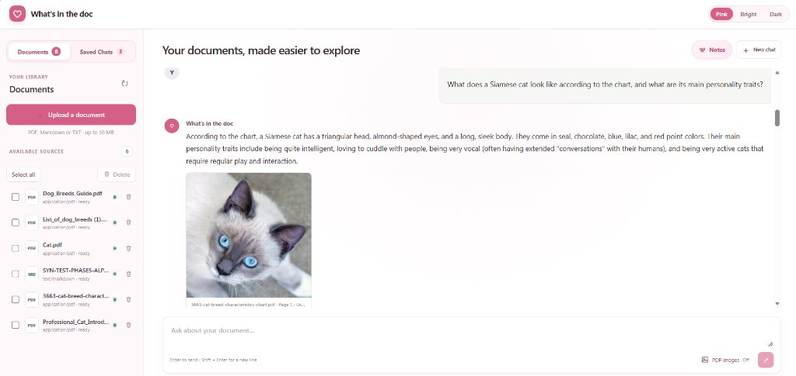
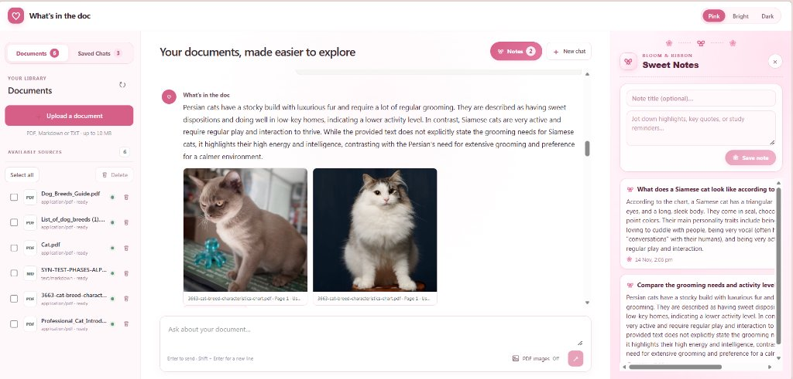

# What’s in the doc — Multimodal Hybrid RAG Platform

An end-to-end, production-grade **Multimodal Hybrid Retrieval-Augmented Generation (RAG)** platform designed for document-grounded question answering with verifiable citations, joint image reasoning, and strict evidence abstention.

---

## 📸 Platform Showcase

### 1. Multimodal Document Q&A & Inline Figure Citations
Grounds visual and text queries across uploaded PDFs and charts using **CLIP embeddings** and **Groq Vision (`qwen/qwen3.8-27b`)**, rendering cited inline figures with exact page numbers.



### 2. Sweet Notes Drawer & Theme Customizer
Built-in floral side-drawer for study notes with one-click **🌸 Save to notes** from assistant responses, ChatGPT-style conversation persistence, and instant theme switching (Soft Pink 🎀, Bright ☀️, and Dark 🌙).



---

## ⚡ Core Engineering Highlights

- **Hybrid Retrieval Pipeline**: Combines dense semantic vector search (`BAAI/bge-small-en-v1.5`, 384-d Cosine HNSW in `pgvector`) with sparse lexical search (`rank-bm25`) to eliminate keyword blindspots and acronym fragility.
- **Reciprocal Rank Fusion (RRF) & Reranking**: Merges candidate lists ($k=60$) before reranking top passages using `cross-encoder/ms-marco-MiniLM-L-6-v2` for high retrieval precision.
- **Multimodal Visual Grounding**: Ingests figures from PDFs, indexes them with `sentence-transformers/clip-ViT-B-32` (512-d), and executes visual reasoning via Groq Vision with inline figure citations.
- **Verifiable Citations & Anti-Hallucination**: Every generated claim is mapped to an exact chunk UUID and page reference. Enforces strict evidence abstention when documents lack sufficient proof.
- **Real-Time Token Streaming**: Server-Sent Events (SSE) stream retrieval status updates, token deltas, and completion latency directly to the React UI.
- **ChatGPT-Style Saved Chats**: Multi-conversation history stored in PostgreSQL with persistent thread switching, real-time message previews, and batch deletion.
- **Duplicate Document Guard**: Real-time filename and SHA-256 content deduplication returning clean HTTP 409 Conflict alerts.
- **Rich Markdown & Table Renderer**: Automatic rendering of structured subtopics, bulleted highlights, and styled GFM comparison tables.

---

## 🏗️ Architecture

```
                                  ┌─────────────────────────────┐
                                  │ React SPA (Vite + Tailwind) │
                                  │    http://localhost:8080    │
                                  └──────────────┬──────────────┘
                                                 │ (HTTP / SSE Streaming)
                                                 ▼
                                  ┌─────────────────────────────┐
                                  │ Nginx Reverse Proxy (/api/*)│
                                  └──────────────┬──────────────┘
                                                 │
                                                 ▼
┌─────────────────────────────────────────────────────────────────────────────────────────┐
│                               FastAPI Application (Port 8000)                           │
│                                                                                         │
│  [User Query] ──► [Hybrid Retrieval] ──► [RRF Fusion] ──► [Cross-Encoder Reranker]     │
│                            │                                        │                   │
│                            ▼                                        ▼                   │
│                  [Dense BGE + Sparse BM25]                 [Verified Context]           │
│                                                                     │                   │
│  [SSE Token Stream] ◄── [Evidence Abstention / Citations] ◄── [Groq Vision LLM]         │
└────────────────────────────────────────┬────────────────────────────────────────────────┘
                                         │
             ┌───────────────────────────┴───────────────────────────┐
             ▼                                                       ▼
 ┌───────────────────────────────┐                       ┌───────────────────────┐
 │    PostgreSQL 16 + pgvector   │                       │    Groq Cloud API     │
 │ • 384-d Text Chunks (HNSW)    │                       │ • openai/gpt-oss-20b  │
 │ • 512-d CLIP Image Vectors    │                       │ • qwen/qwen3.8-27b    │
 │ • Chat Threads & Message Log  │                       │ • Fast Streaming      │
 └───────────────────────────────┘                       └───────────────────────┘
```

---

## 🛠️ Tech Stack

| Layer | Technologies |
| :--- | :--- |
| **Backend & API** | Python 3.11, FastAPI, Uvicorn, Pydantic v2, SQLAlchemy 2 (async), Psycopg 3 |
| **Vector & Database** | PostgreSQL 16 with `pgvector` extension (HNSW indexing) |
| **Embeddings & NLP** | `BAAI/bge-small-en-v1.5`, `sentence-transformers/clip-ViT-B-32`, `cross-encoder/ms-marco-MiniLM-L-6-v2`, `rank-bm25` |
| **LLM Inference** | Groq Cloud API SDK (`qwen/qwen3.8-27b`, `openai/gpt-oss-20b`), Ollama fallback |
| **Frontend UI** | React 18, TypeScript, Vite, React-Markdown, Remark-GFM, Lucide icons |
| **Proxy & DevOps** | Nginx, Docker, Docker Compose |

---

## 🚀 Quickstart

### Prerequisites
- [Docker](https://www.docker.com/) & Docker Compose
- A [Groq API Key](https://console.groq.com/)

### 1. Clone & Configure
```bash
git clone https://github.com/kritu2208/hybrid-rag.git
cd hybrid-rag
cp .env.example .env
```
Add your Groq API key in `.env`:
```env
GROQ_API_KEY=gsk_your_groq_api_key_here
```

### 2. Launch with Docker Compose
```bash
docker compose up -d --build
```
Once healthy, open **[http://localhost:8080](http://localhost:8080)** in your browser.

*(Sample demo documents with high-res figures are available in [`demo_docs/`](demo_docs/)).*

---

## 🧪 Testing & Verification

The test suite covers end-to-end ingestion, token-aware chunking, hybrid fusion, reranking, Groq streaming, and conversation persistence:

```bash
# Run backend pytest suite (188 tests passing)
pytest backend/tests -v
```

---

## 📄 License
This project is open-source under the MIT License.
