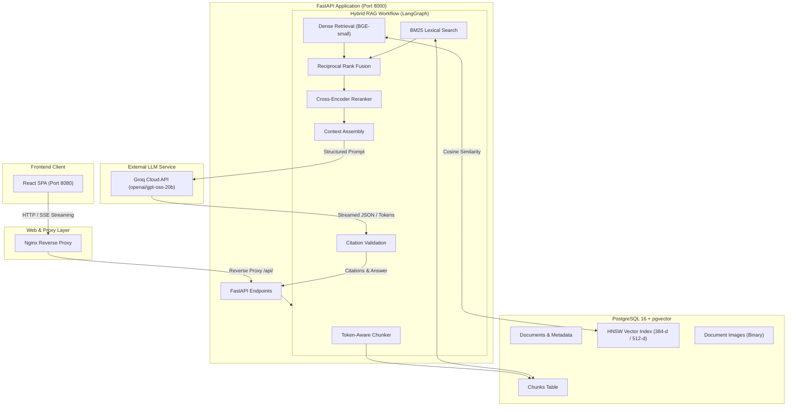

# Hybrid RAG Document Q&A with Retrieval Evaluation

An end-to-end, production-grade Hybrid Retrieval-Augmented Generation (RAG) platform designed for document-grounded question answering with verifiable citations, strict evidence abstention, and offline evaluation.

```
                    ┌────────────────────────────────────────┐
                    │       React SPA (Vite + Tailwind)      │
                    │         http://localhost:8080          │
                    └───────────────────┬────────────────────┘
                                        │ (HTTP / SSE Streaming)
                                        ▼
                    ┌────────────────────────────────────────┐
                    │      Nginx Reverse Proxy (/api/*)      │
                    └───────────────────┬────────────────────┘
                                        │
                                        ▼
┌─────────────────────────────────────────────────────────────────────────────────┐
│                          FastAPI Backend (Port 8000)                            │
│                                                                                 │
│   ┌─────────────────────────────────────────────────────────────────────────┐   │
│   │                         LangGraph RAG Workflow                          │   │
│   │                                                                         │   │
│   │   [Question] ──► [Receive & Route] ──► [Hybrid Retrieval]               │   │
│   │                                                │                        │   │
│   │   [SSE Stream] ◄── [Verify Citations] ◄── [Reranking & Context]         │   │
│   └────────────────────────────────────────────────┬────────────────────────┘   │
└───────────────────────┬────────────────────────────┼────────────────────────────┘
                        │                            │
                        ▼                            ▼
        ┌──────────────────────────────┐   ┌──────────────────────────────┐
        │    PostgreSQL 16 + pgvector  │   │       Groq Cloud LLM         │
        │                              │   │                              │
        │ • 384-d Chunks (Cosine HNSW) │   │ • openai/gpt-oss-20b         │
        │ • BM25 Lexical Inverted Index│   │ • qwen/qwen3.8-27b (Vision)  │
        │ • 512-d CLIP Image Vectors   │   │ • Sub-3s Streaming Responses │
        │ • Binary Image Attachments   │   │ • Strict JSON Output Schema  │
        └──────────────────────────────┘   └──────────────────────────────┘
```

---

## 1. Project Overview

Traditional RAG systems frequently suffer from three critical failure modes:
1. **Dense Retrieval Blindspots**: Vector search often fails on precise technical identifiers, serial numbers, codes, or domain-specific acronyms.
2. **Lexical Keyword Fragility**: BM25 and keyword search fail when users ask conceptual questions that do not share exact vocabulary with the source documents.
3. **Hallucination & Misattribution**: Large language models extrapolate unsupported claims when context is incomplete or fail to provide exact, verifiable citations.

**Hybrid RAG solves these challenges** by pairing dense vector similarity with sparse BM25 keyword search, fusing candidate lists via **Reciprocal Rank Fusion (RRF)**, and refining candidate ordering using a **Cross-Encoder reranker**. Retrieved passages are validated through a stateful **LangGraph** workflow that enforces citation grounding and triggers **explicit evidence abstention** when source material lacks sufficient evidence.

---

## 2. Key Features

- **Document Ingestion & Parsing**: Native ingestion of `.pdf`, `.md`, and `.txt` files up to 10MB with token-aware chunking (500 tokens, 50-token overlap).
- **Dense Vector Search**: 384-dimensional dense semantic embeddings generated by `BAAI/bge-small-en-v1.5`, stored in PostgreSQL using `pgvector` with HNSW cosine distance indexing.
- **BM25 Lexical Search**: Full-text candidate retrieval with configurable candidate limits to capture exact keyword matches.
- **Reciprocal Rank Fusion (RRF) & Cross-Encoder Reranking**: Merges dense and lexical candidate ranks ($k=60$) before reranking top candidates with `cross-encoder/ms-marco-MiniLM-L-6-v2`.
- **Fast, Grounded LLM Generation**: Remote inference powered by Groq (`openai/gpt-oss-20b`) with a local Ollama fallback.
- **Verifiable Citations**: Every generated statement is linked to an exact source chunk UUID, document name, and page number.
- **Strict Evidence Abstention**: Explicitly detects unanswerable queries and returns an abstention message without hallucinating facts.
- **Real-Time Token Streaming**: Server-Sent Events (SSE) stream status updates (`retrieving`, `generating`), token deltas, and completion payloads directly to the frontend.
- **Automated Evaluation Suite**: Automated offline runners to assess retrieval performance (Recall@k, MRR, nDCG) and generated answer quality (Faithfulness, Answer Relevancy, Citation Semantic Support, and Abstention Confusion Matrices).

---

## 3. Tech Stack

- **Backend Framework**: Python 3.11, FastAPI, Uvicorn, Pydantic v2.
- **RAG Orchestration**: LangGraph, SQLAlchemy 2 (async-compatible 2.0 style), Psycopg 3.
- **Vector & Relational Database**: PostgreSQL 16 with `pgvector` extension 0.8.x.
- **Machine Learning & NLP**:
  - Dense Embeddings: `BAAI/bge-small-en-v1.5` (Sentence-Transformers).
  - Reranker: `cross-encoder/ms-marco-MiniLM-L-6-v2`.
  - Multimodal Vision Vectors: `sentence-transformers/clip-ViT-B-32`.
  - Lexical Search: `rank-bm25`.
- **LLM Inference**: Groq Cloud API SDK (`groq`), optional local Ollama.
- **Frontend SPA**: React 18, TypeScript, Vite, TailwindCSS, Lucide-react.
- **Web Server & Reverse Proxy**: Nginx (unprivileged container).
- **Containerization**: Docker, Docker Compose.

---

## 4. Architecture & Pipeline



---

## 5. Quickstart (Docker Compose)

### Prerequisites
- Docker Desktop (or Docker Engine with Compose plugin).
- A Groq API key (sign up free at [console.groq.com](https://console.groq.com)).

### 1. Configure Environment
Clone the repository and create your local `.env` file:

```bash
cp .env.example .env
```

Open `.env` and set your credentials:
```ini
# Database credentials
POSTGRES_DB=hybrid_rag
POSTGRES_USER=hybrid_rag
POSTGRES_PASSWORD=your_secure_local_password
DATABASE_URL=postgresql+psycopg://hybrid_rag:your_secure_local_password@db:5432/hybrid_rag

# Active LLM Provider (Groq)
LLM_PROVIDER=groq
GROQ_API_KEY=your_actual_groq_api_key_here
GROQ_MODEL=openai/gpt-oss-20b
GROQ_VISION_MODEL=qwen/qwen3.8-27b
```

> **Important (Port Conflict Prevention on Windows)**:  
> If your host machine already runs a native PostgreSQL service on port `5432`, avoid port collisions by mapping the container's external port to `5433`:
> 
> ```powershell
> # PowerShell:
> $env:POSTGRES_PORT="5433"
> docker compose up -d
> ```
> ```bash
> # Linux / macOS:
> POSTGRES_PORT=5433 docker compose up -d
> ```

### 2. Apply Database Migrations
On a fresh installation, run Alembic migrations to set up the schema and pgvector indexes:

```bash
docker compose run --rm backend alembic upgrade head
```

### 3. Start the Application Stack
```bash
docker compose up -d
```

### 4. Access the Services
- **Web Application**: [`http://localhost:8080`](http://localhost:8080)
- **Interactive OpenAPI Docs**: [`http://localhost:8000/docs`](http://localhost:8000/docs)
- **Backend Health Check**: [`http://localhost:8000/api/health`](http://localhost:8000/api/health)

To stop services:
```bash
docker compose down
```
*(Data in `postgres_data` persists across container restarts)*.

---

## 6. Demo Walkthrough

### Scenario A: Ingesting & Querying Grounded Facts
1. Open the UI at [`http://localhost:8080`](http://localhost:8080).
2. Upload the provided test document `scratch/SYN-TEST-PHASE5-ALPHA.md` (or any PDF/Markdown document).
3. Select the document in the sidebar.
4. Ask:
   > *"What is the dedicated telemetry frequency and calibration duration?"*
5. **Expected Result**:
   - Answer: Explains that the telemetry frequency is **433.92 MHz** and the calibration duration is **417 seconds**.
   - **Click "View sources"**: Expands chunk citation card showing the exact chunk UUID, document title, and source excerpt.

### Scenario B: Strict Evidence Abstention (Anti-Hallucination)
1. With the same document selected, ask a question regarding unmentioned details:
   > *"What is the projected 2027 budget for Project Pegasus?"*
2. **Expected Result**:
   - Answer: *"The uploaded documents do not provide enough information to answer this question."*
   - Citations: Returns **zero citations** (`citations: []`), confirming the LLM refused to extrapolate unsupported facts.

### Scenario C: Server-Sent Events (SSE) Streaming
Observe the live streaming indicators:
- The UI displays dynamic status transitions: `Searching sources...` $\to$ `Generating answer...`
- Tokens stream in real time with an elapsed latency badge (e.g., `Answered in 2.5s`).

---

## 7. Evaluation Framework

The project includes offline evaluation suites to measure both retrieval quality and answer generation accuracy against synthetic benchmark corpora.

### Retrieval Evaluation
Measures the effectiveness of dense vs. BM25 vs. hybrid vs. reranked retrieval modes:
- **Recall@k**: Proportion of ground-truth relevant chunks retrieved in top-$k$.
- **MRR (Mean Reciprocal Rank)**: Evaluates how high the first relevant chunk appears.
- **nDCG (Normalized Discounted Cumulative Gain)**: Measures ranking quality with graded relevance.

```bash
# Run retrieval evaluation against test dataset:
docker compose run --rm backend python -m scripts.run_evaluation --help
```

### Automated Answer Quality & Abstention Judge
Located in `backend/app/evaluation/quality.py`, an automated LLM judge evaluates end-to-end answers:
- **Faithfulness**: Verifies whether each factual claim made by the LLM is directly entailed by the retrieved chunks.
- **Answer Relevancy**: Assesses whether the generated response directly answers the user's question.
- **Citation Semantic Support**: Validates semantic alignment between claims and their specific cited chunk IDs.
- **Abstention Confusion Matrix**: Categorizes responses into True Abstentions (correct refusal), False Abstentions (refused despite context), and Hallucinations (answered without evidence).

```bash
# Run automated quality evaluation:
docker compose run --rm backend python -m scripts.run_quality_evaluation --provider mock --output-dir evaluation_outputs
```
*(Note: Automated evaluations require a dataset mapping file; see `backend/evaluation_datasets/README.md`)*.

---

## 8. Demo & UI Showcase

<!-- Placeholders for project showcase assets -->
| Document Library & Upload | Grounded Citations & Sources |
| :---: | :---: |
| _[ Screenshot: Document sidebar with chunking badges and upload dropzone ]_ | _[ Screenshot: View sources drawer with chunk UUID and highlighted excerpt ]_ |

| Real-Time SSE Streaming | Strict Evidence Abstention |
| :---: | :---: |
| _[ Screenshot: Token-by-token streaming with latency measurement ]_ | _[ Screenshot: Clean abstention response on out-of-domain query ]_ |

*(Video walkthrough available upon request)*.

---

## 9. Current Technical Limitations

- **Multimodal Image Search Latency**: Ingested PDF figures are embedded using `sentence-transformers/clip-ViT-B-32` on CPU. Because the 600MB CLIP weights load lazily, enabling **"PDF images: On"** on the first request introduces cold-start latency. For live text demos, keeping the default toggle (**Off**) is recommended.
- **Cold-Start Model Caching**: On fresh Docker deployments where volume cache is not pre-populated, the first dense query downloads model weights from HuggingFace Hub (~133MB).
- **Authentication & Multi-Tenancy**: The current local development stack does not implement user login or role-based access control; all uploaded documents and conversations are currently accessible within the shared workspace.

---

## 10. Roadmap & Future Improvements

- [ ] **Docker Model Pre-Baking**: Pre-download embedding and cross-encoder weights into the Docker image build stage to eliminate first-request cold-start delays.
- [ ] **Production Ingress & SSL**: Provide automated Caddy / Nginx reverse proxy configurations with Let's Encrypt for single-command VPS deployment.
- [ ] **API Authentication & Rate Limiting**: Introduce JWT / API token middleware to protect document deletion and chat endpoints under public traffic.
- [ ] **Asynchronous Ingestion Queue**: Offload heavy multi-page PDF image extraction and embeddings to a background Celery / Redis worker queue.
